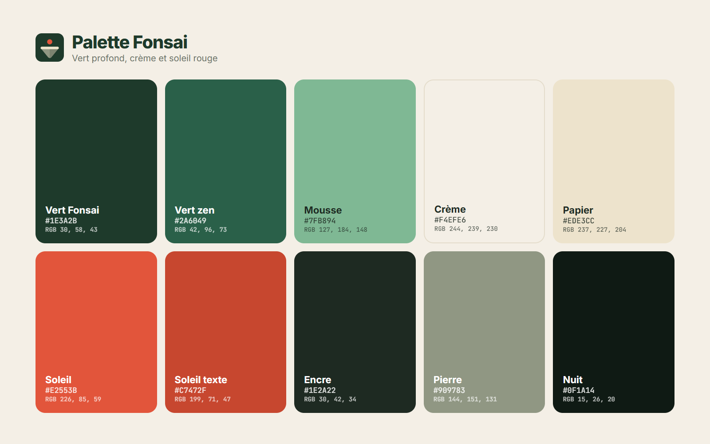

# Couleurs Fonsai

| Nom | Hex | RGB | Usage |
|---|---|---|---|
| Vert Fonsai | `#1E3A2B` | 30, 58, 43 | Couleur de marque : logo, fonds forts, boutons principaux |
| Vert zen | `#2A6049` | 42, 96, 73 | Boutons et liens sur fond clair, couleur par défaut de l'app |
| Mousse | `#7FB894` | 127, 184, 148 | Accent sur fond sombre |
| Crème | `#F4EFE6` | 244, 239, 230 | Fond principal du site et des documents |
| Papier | `#EDE3CC` | 237, 227, 204 | L'île du logo, surfaces douces |
| Soleil | `#E2553B` | 226, 85, 59 | Le soleil du logo, petites touches d'accent |
| Soleil texte | `#C7472F` | 199, 71, 47 | Accroches et sur-titres en rouge, lisibles sur crème |
| Encre | `#1E2A22` | 30, 42, 34 | Texte principal |
| Pierre | `#909783` | 144, 151, 131 | Le dessous de l'île, textes secondaires sur fond vert |
| Nuit | `#0F1A14` | 15, 26, 20 | Fond du thème sombre |

## Règles

- **Le vert domine, le rouge ponctue.** Le Soleil n'est jamais une couleur de fond ni de grand bouton : il attire l'œil sur un détail (le soleil du logo, une accroche, un badge).
- **Fond clair = Crème**, pas blanc pur. **Fond sombre = Nuit**, pas noir pur.
- **Texte sur Vert Fonsai** : Crème ou Papier. **Texte sur Crème** : Encre.
- Dans l'app, le rouge reste réservé aux alertes (retards, aujourd'hui) : ne pas l'utiliser pour les boutons.
